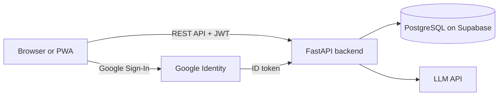

<div align="center">

# Ascendra

**Intelligence That Moves You Forward.**

An AI-powered career platform for smarter resumes, personalized insights, and interview readiness.

[](https://ai-career-copilot-2-pu0m.onrender.com)


*The first load can take up to a minute because the app runs on a free hosting plan and wakes up from sleep.*

</div>

---

## Screenshots


### How it helps you

<!-- Drag and drop your video into the GitHub editor and paste the generated link on its own line below. -->


https://github.com/user-attachments/assets/8319dc6f-8500-43da-8d59-6df1db89b555


---

## Why Ascendra?

Preparing for a job usually means juggling a resume, a job description, practice questions and a calendar in different places. Ascendra puts them in one workspace that shares a single profile, so every tool gets more useful the more you use it.

---

## Features

### Resume
- **Resume match:** compare your resume with a job description and get a match score, strengths, skill gaps and the questions that job is likely to ask.
- **Bullet rewrite and cover letter:** draft both using only what is in your resume and the job description.

### Interview practice
- **Interview coach:** practice one question at a time by text or voice. Choose the round, the level and the language (English or Hinglish).
- **Interview scorecard:** AI-estimated practice feedback with PDF export.
- **Question bank:** ready questions with model answers for behavioral, technical, HR and situational rounds, plus an AI generator for any role.

### Planning and tracking
- **Prep planner:** a day-by-day checklist built from your resume match and interview date.
- **Job tracker:** keep applications, statuses, interview dates and notes in one place.
- **Calendar reminder (.ics) and practice chart** to track progress over time.

### Knowledge base
- Upload your own PDFs and ask questions that are answered from your documents.

### Account and experience
- Google sign-in or username and password, with password reset by email.
- Saved chats, documents and analyses, available on any device.
- Light and dark themes, adjustable text size, voice dictation and read-aloud replies.
- Installable as a Progressive Web App.
- Export your data or delete your account at any time.

---

## How it works



1. The frontend is a single-page app served by the backend.
2. FastAPI handles authentication (JWT and Google Sign-In), business logic and database access through SQLAlchemy.
3. Resume analysis, coaching, questions and document answers are generated by an LLM API.
4. Chats, documents and analyses are stored per user in PostgreSQL.

---

## Tech stack

| Layer | Technology |
| --- | --- |
| Backend | FastAPI, SQLAlchemy |
| Database | PostgreSQL (Supabase) |
| Auth | JWT, Google Sign-In |
| AI | LLM API |
| Frontend | HTML, CSS, JavaScript (no framework) |
| Icons and fonts | Phosphor Icons, DM Sans, Fraunces |
| PWA | Web app manifest, service worker |
| Hosting | Render |

---

## Run locally

**1. Clone and create a virtual environment**

```bash
git clone <https://github.com/tanishka2105/Ai-Career-copilot->
cd <Ai-Career-copilot->
python -m venv .venv
```

Activate it:

```bash
# Windows
.venv\Scripts\activate

# macOS / Linux
source .venv/bin/activate
```

**2. Install dependencies**

```bash
pip install -r requirements.txt
```

**3. Create a `.env` file**

| Variable | Purpose |
| --- | --- |
| `DATABASE_URL` | PostgreSQL connection string |
| `JWT_SECRET` | Secret used to sign login tokens |
| `GOOGLE_CLIENT_ID` | Google Sign-In client ID |
| AI API key | Key for the LLM provider you use |
| `BASE_URL` | Public URL of the app, used in emails |
| `SMTP_*` | Mail settings for password reset |

**4. Start the server**

```bash
uvicorn main:app --reload
```

Then open `http://127.0.0.1:8000`.

---

## Tests

```bash
pip install -r requirements-dev.txt
pytest
```

---

## Privacy and security

Resumes are personal data, so privacy is part of the design.

- Documents are used only to answer your own requests.
- You can delete chats, documents or your whole account from Settings, and export your data.
- The service worker never caches API calls, so private data does not sit in a shared cache.
- Never commit your `.env` file.
- The app includes a Privacy Policy and Terms of Use page.

Interview scorecards are AI-estimated practice feedback, not a prediction of real interview results.

---

## Project structure (frontend)

```text
index.html       App shell and all views
style.css        Theme, layout and responsive styles
app.js           Frontend logic
sw.js            Service worker (offline fallback, network first)
manifest.json    PWA manifest
```

---

## Author

Built by **Tanishka**, a Computer Science student focused on generative AI.

- GitHub: `https://github.com/tanishka2105`
- LinkedIn: `www.linkedin.com/in/tanishkachaudhary`

If you found this useful, consider giving the repository a star.
