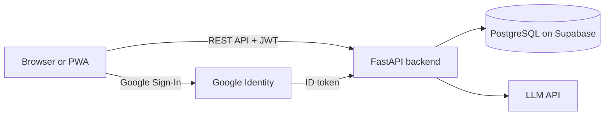

<div align="center">

# Ascendra

**Intelligence That Moves You Forward.**

**Career Pivot Coach**: an AI-powered career platform that finds your skill gaps, builds your learning plan, scores your mock interviews and learns from your job applications.

[](https://ai-career-copilot-2-pu0m.onrender.com)


*The first load can take up to a minute because the app runs on a free hosting plan and wakes up from sleep.*

</div>

---

## Screenshots


---

## The problem

Changing careers, or landing a first role in a new field, is confusing. You do not know which skills the job really needs, what to learn first, how ready you are for the interview, or which applications are actually working. Most tools solve only one of these and forget you the next day.

## The solution

Ascendra is a **Career Pivot Coach**. It takes your resume and your target role, finds the gap using real job descriptions, turns it into a week-by-week plan, tests you with scored mock interviews, and keeps adjusting the plan as you progress. Everything shares one profile, so each tool gets smarter the more you use it.

---

## Career Pivot Coach: how it works

| Step | What Ascendra does |
| --- | --- |
| 1. Intake | You upload your resume and choose a target role. |
| 2. Skill-gap map | Real job descriptions are compared with your resume. You see matched skills, missing skills and priorities. |
| 3. Weekly learning plan | The gaps become a week-by-week plan with tasks you can tick off. |
| 4. Portfolio projects | Project ideas matched to your specific gaps, so your learning produces proof of skill. |
| 5. Mock interviews | Questions for your target role. Each answer is scored against a rubric (clarity, technical depth, examples, communication) with feedback. |
| 6. Progress tracking | Completed tasks and interview scores adjust the plan, so weak areas get more time. |
| 7. Application tracker | Track every application. Ascendra shows which kinds of roles are giving you responses. |

---

## Features

### Resume and skill gaps
- **Resume match:** compare your resume with a job description and get a match score, strengths, skill gaps and the questions that job is likely to ask.
- **Skill-gap map:** built from real job descriptions for your target role.
- **Bullet rewrite and cover letter:** draft both using only what is in your resume and the job description.

### Learning plan and projects
- **Prep planner:** a day-by-day and week-by-week checklist built from your skill gaps and interview date.
- **Portfolio project suggestions** matched to your gaps.
- **Adaptive plan:** updates automatically from your progress and interview scores.

### Interview practice
- **Interview coach:** practice one question at a time by text or voice. Choose the round, the level and the language (English or Hinglish).
- **Rubric scoring:** every answer is scored against a visible rubric with feedback.
- **Interview scorecard:** AI-estimated practice feedback with PDF export.
- **Question bank:** ready questions with model answers for behavioral, technical, HR and situational rounds, plus an AI generator for any role.

### Tracking
- **Job tracker:** keep applications, statuses, interview dates and notes in one place.
- **Response insights:** see which kinds of roles get replies.
- **Calendar reminder (.ics) and practice chart** to track progress over time.

### Knowledge base
- Upload your own PDFs and ask questions that are answered from your documents.

### Account and experience
- Google sign-in or username and password, with password reset by email.
- Saved chats, documents and analyses, available on any device.
- Light and dark themes, adjustable text size, voice dictation and read-aloud replies.
- Installable as a Progressive Web App.
- Export your data or delete your account at any time.

---

## Architecture



1. The frontend is a single-page app served by the backend.
2. FastAPI handles authentication (JWT and Google Sign-In), business logic and database access through SQLAlchemy.
3. Skill-gap analysis, learning plans, project ideas, interview scoring and document answers are generated by an LLM API.
4. Chats, documents, plans, progress and applications are stored per user in PostgreSQL.

### Data flow

```text
Resume + target role -> Skill-gap map -> Weekly plan -> Mock interview -> Progress -> Plan adjusts
                                                                      \-> Application tracker insights
```

---

## Tech stack

| Layer | Technology |
| --- | --- |
| Backend | FastAPI, SQLAlchemy |
| Database | PostgreSQL (Supabase) |
| Auth | JWT, Google Sign-In |
| AI | LLM API |
| Frontend | HTML, CSS, JavaScript (no framework) |
| Icons and fonts | Phosphor Icons, DM Sans, Fraunces |
| PWA | Web app manifest, service worker |
| Hosting | Render |

---

## Run locally

**1. Clone and create a virtual environment**

```bash
git clone https://github.com/tanishka2105/Ai-Career-copilot-.git
cd Ai-Career-copilot-
python -m venv .venv
```

Activate it:

```bash
# Windows
.venv\Scripts\activate

# macOS / Linux
source .venv/bin/activate
```

**2. Install dependencies**

```bash
pip install -r requirements.txt
```

**3. Create a `.env` file**

| Variable | Purpose |
| --- | --- |
| `DATABASE_URL` | PostgreSQL connection string |
| `JWT_SECRET` | Secret used to sign login tokens |
| `GOOGLE_CLIENT_ID` | Google Sign-In client ID |
| AI API key | Key for the LLM provider you use |
| `BASE_URL` | Public URL of the app, used in emails |
| `SMTP_*` | Mail settings for password reset |

**4. Start the server**

```bash
uvicorn main:app --reload
```

Then open `http://127.0.0.1:8000`.

---

## Tests

```bash
pip install -r requirements-dev.txt
pytest
```

---

## Privacy and security

Resumes are personal data, so privacy is part of the design.

- Documents are used only to answer your own requests.
- You can delete chats, documents or your whole account from Settings, and export your data.
- The service worker never caches API calls, so private data does not sit in a shared cache.
- API keys and secrets live only in environment variables. Never commit your `.env` file.
- The app includes a Privacy Policy and Terms of Use page.

Interview scorecards and skill-gap results are AI-estimated guidance, not a guarantee of real interview or hiring outcomes.

---

## Project structure (frontend)

```text
index.html       App shell and all views
style.css        Theme, layout and responsive styles
app.js           Frontend logic
sw.js            Service worker (offline fallback, network first)
manifest.json    PWA manifest
```

---

## Author

Built by **Tanishka Chaudhary**, a Computer Science student focused on generative AI.

- GitHub: [github.com/tanishka2105](https://github.com/tanishka2105)
- LinkedIn: [linkedin.com/in/tanishkachaudhary](https://www.linkedin.com/in/tanishkachaudhary)

If you found this useful, consider giving the repository a star.
